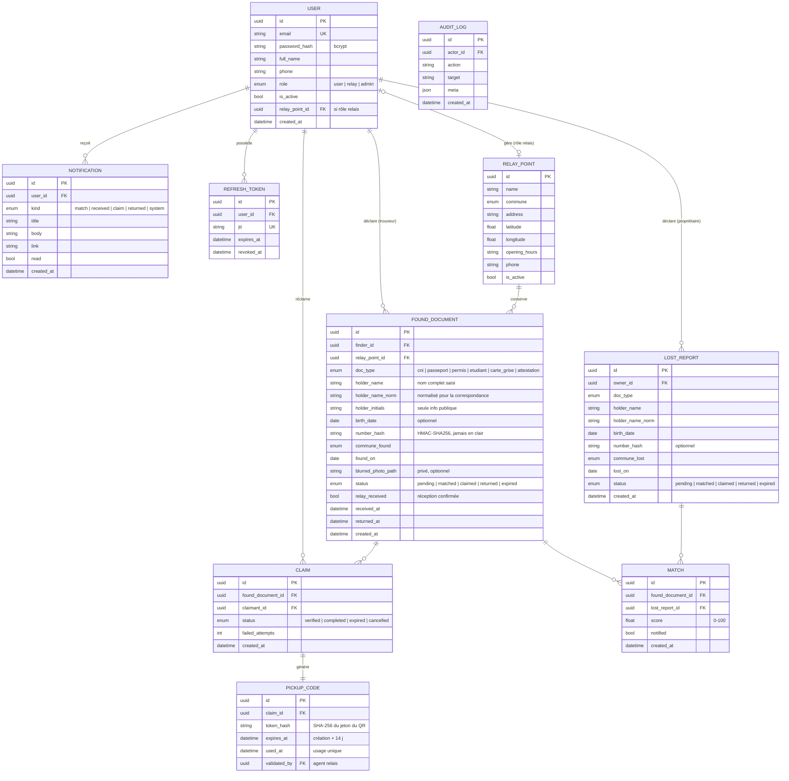
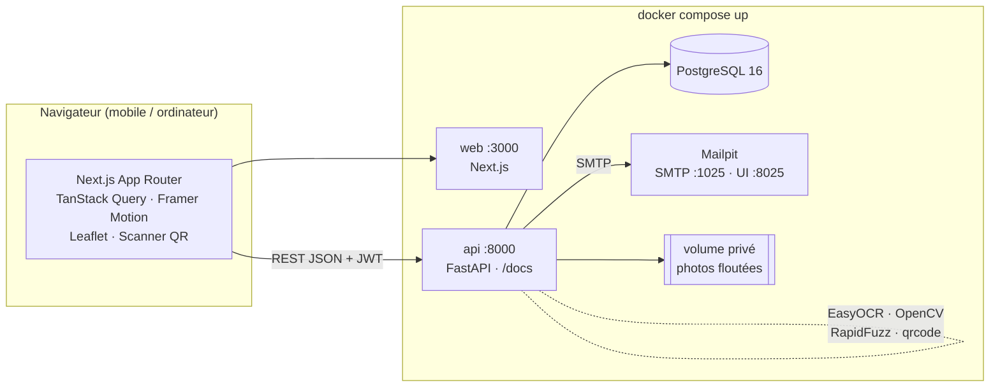

# Orea — Phase 1 : Plan

> Document de conception à valider avant de démarrer le backend.
> Chaque décision non couverte par le cahier des charges est signalée par **▸ Décision**.

---

## 1. Arborescence du projet

Monorepo à deux applications (`backend/`, `frontend/`) orchestrées par un seul `docker-compose.yml`.

```
orea/
├── docker-compose.yml            # db + api + web + mailpit, une seule commande
├── .env.example                  # toutes les variables documentées
├── README.md
├── SCENARIO_DEMO.md
├── docs/
│   ├── PHASE1_PLAN.md            # ce document
│   ├── architecture.md           # schémas Mermaid (BDD + architecture)
│   └── captures/                 # captures d'écran pour le README
│
├── backend/
│   ├── Dockerfile
│   ├── pyproject.toml            # dépendances + config pytest/ruff
│   ├── alembic.ini
│   ├── alembic/versions/         # migrations
│   ├── app/
│   │   ├── main.py               # création de l'app FastAPI, CORS, middlewares, routers
│   │   ├── core/
│   │   │   ├── config.py         # Settings Pydantic (lecture du .env)
│   │   │   ├── security.py       # bcrypt, JWT, hachage HMAC des numéros
│   │   │   ├── rate_limit.py     # limiteur (slowapi)
│   │   │   └── errors.py         # exceptions métier + handlers JSON en français
│   │   ├── db/
│   │   │   ├── base.py           # DeclarativeBase SQLAlchemy 2
│   │   │   └── session.py        # engine + get_db()
│   │   ├── models/               # SQLAlchemy : user, relay_point, found_document,
│   │   │                         #   lost_report, match, claim, pickup_code,
│   │   │                         #   notification, refresh_token, audit_log
│   │   ├── schemas/              # Pydantic v2 : entrées / sorties de l'API
│   │   ├── api/
│   │   │   ├── deps.py           # get_current_user, require_role(...)
│   │   │   └── routes/           # auth, users, found, lost, search, claims,
│   │   │                         #   relay, admin, ocr, notifications, stats, meta
│   │   ├── services/             # logique métier (aucune dépendance HTTP)
│   │   │   ├── auth_service.py
│   │   │   ├── declaration_service.py
│   │   │   ├── matching_service.py   # normalisation + RapidFuzz
│   │   │   ├── claim_service.py      # vérification numéro + QR
│   │   │   ├── qr_service.py
│   │   │   ├── ocr_service.py        # EasyOCR + parsing par type de pièce
│   │   │   ├── blur_service.py       # OpenCV
│   │   │   ├── notification_service.py
│   │   │   ├── email_service.py      # SMTP + gabarits HTML
│   │   │   └── stats_service.py
│   │   ├── templates/emails/     # e-mails HTML (Jinja2) aux couleurs d'Orea
│   │   └── utils/                # normalisation de texte, communes, dates
│   ├── scripts/
│   │   ├── seed.py               # comptes, 6 points relais, déclarations fictives
│   │   └── make_specimens.py     # génère 3 fausses pièces « SPÉCIMEN »
│   ├── specimens/                # les 3 images générées
│   └── tests/                    # pytest : matching, hachage, QR, routes
│
└── frontend/
    ├── Dockerfile
    ├── package.json
    ├── components.json           # config shadcn/ui
    ├── public/brand/             # logo (non modifié), favicon
    └── src/
        ├── app/
        │   ├── (marketing)/page.tsx          # landing
        │   ├── (auth)/connexion, inscription
        │   ├── recherche/
        │   ├── declarer/trouve/              # parcours « J'ai trouvé » (OCR → relais)
        │   ├── declarer/perdu/
        │   ├── reclamer/[id]/                # vérification + QR
        │   ├── tableau-de-bord/              # espace utilisateur
        │   ├── relais/                       # espace point relais + scanner
        │   └── admin/                        # tableau de bord admin
        ├── components/
        │   ├── ui/               # shadcn personnalisés
        │   ├── brand/            # Logo, Mascotte (états), motifs SVG
        │   ├── illustrations/    # SVG originaux
        │   ├── landing/          # Hero, Marquee, Steps, Bento, Map, Stats, FAQ…
        │   └── feedback/         # EmptyState, ErrorState, Loader, Confetti
        ├── lib/                  # client API, auth, zod schemas, utils
        ├── hooks/                # hooks TanStack Query
        └── styles/globals.css    # tokens de couleur clair/sombre
```

**▸ Décision** : la logique métier vit dans `services/` sans dépendance à FastAPI, ce qui la rend testable directement par pytest et réutilisable par le script de seed.

---

## 2. Schéma de la base de données



**▸ Décisions**
- **Deux tables distinctes** (`found_document`, `lost_report`) plutôt qu'une table générique : les champs et les droits diffèrent, et la table `match` relie proprement les deux sens.
- **Hachage du numéro en HMAC-SHA256** avec une clé secrète (`DOC_NUMBER_PEPPER`) : c'est la forme standard d'un « SHA-256 avec sel secret », résistante aux attaques par extension. Le numéro est normalisé avant hachage (majuscules, sans espaces ni tirets).
- **Le QR code contient un jeton aléatoire de 256 bits ; seule son empreinte SHA-256 est stockée.** Une fuite de la base ne permet donc pas de forger un QR.
- **Le nom du titulaire est conservé** (nécessaire à la correspondance) mais n'est jamais renvoyé par les routes publiques : seules les initiales sortent.
- **Une `audit_log`** trace les actions sensibles (vérification, restitution, modération) : un argument de poids devant le jury sur la sécurité.
- **L'expiration** (déclarations sans suite après 90 jours, QR après 14 jours) est appliquée par une tâche planifiée légère au démarrage de l'API et toutes les heures, sans Celery.

---

## 3. Routes de l'API (`/api/v1`, documentées sur `/docs`)

| Méthode | Route | Rôle | Description |
|---|---|---|---|
| **Auth** ||||
| POST | `/auth/register` | public | Inscription |
| POST | `/auth/login` | public | Renvoie l'access token ; refresh token en cookie httpOnly |
| POST | `/auth/refresh` | cookie | Rotation du refresh token |
| POST | `/auth/logout` | connecté | Révoque le refresh token |
| GET / PATCH | `/users/me` | connecté | Lire / modifier son profil |
| **Référentiels** ||||
| GET | `/meta/doc-types` | public | Types de pièces acceptées |
| GET | `/meta/communes` | public | Les 13 communes d'Abidjan |
| GET | `/relay-points` | public | Liste et coordonnées des points relais (carte) |
| GET | `/stats/public` | public | Compteurs de la landing (en cache 60 s) |
| **OCR** ||||
| POST | `/ocr/scan` | connecté, limité | Photo → champs pré-remplis + `upload_id` de la photo floutée |
| **Pièces trouvées** ||||
| POST | `/found` | connecté | Déclarer une pièce trouvée (lance la correspondance) |
| GET | `/found/mine` | connecté | Mes pièces trouvées |
| GET | `/found/{id}` | propriétaire / relais / admin | Détail |
| **Pertes** ||||
| POST | `/lost` | connecté | Déclarer une perte (lance la correspondance) |
| GET | `/lost/mine` | connecté | Mes pertes et leurs correspondances |
| DELETE | `/lost/{id}` | propriétaire | Clôturer une déclaration (pièce retrouvée ailleurs) |
| **Recherche** ||||
| GET | `/search?type=&name=&commune=` | public, limité | Résultats anonymisés : type, initiales, commune, date |
| **Réclamation** ||||
| POST | `/claims` | connecté, limité | `{found_id, number}` → vérifie le hash → crée la réclamation et le QR |
| GET | `/claims/mine` | connecté | Mes réclamations et QR actifs |
| GET | `/claims/{id}/qr.png` | réclamant | Image du QR (générée à la volée) |
| **Point relais** ||||
| GET | `/relay/documents?status=` | relais | Pièces déposées chez lui |
| POST | `/relay/documents/{id}/receive` | relais | Confirmer la réception physique |
| POST | `/relay/pickup/verify` | relais, limité | Scanner un QR → aperçu du retrait (sans le consommer) |
| POST | `/relay/pickup/confirm` | relais | Valider la restitution (QR consommé) |
| **Notifications** ||||
| GET | `/notifications` | connecté | Liste paginée |
| POST | `/notifications/{id}/read`, `/notifications/read-all` | connecté | Marquer comme lu |
| **Admin** ||||
| GET | `/admin/stats` | admin | KPIs, séries temporelles, top communes, taux de réussite |
| CRUD | `/admin/relay-points` | admin | Gestion des points relais |
| GET / PATCH | `/admin/users` | admin | Liste, changement de rôle, désactivation |
| GET / PATCH / DELETE | `/admin/declarations` | admin | Modération |
| GET | `/admin/audit` | admin | Journal d'audit |
| GET | `/health` | public | Sonde Docker |

**▸ Décisions**
- **Vérification en deux temps côté relais** (`verify` puis `confirm`) : l'agent voit d'abord le type de pièce et le nom du réclamant avant de remettre la pièce, ce qui évite qu'un scan accidentel consomme le QR.
- **Limitation de débit avec slowapi** : 30 req/min pour la recherche, 5 tentatives/15 min pour la vérification du numéro par utilisateur et par IP. Au-delà de 5 échecs, la réclamation est verrouillée 24 h et l'admin est alerté.
- **Access token de 15 min gardé en mémoire et refresh token de 7 jours en cookie httpOnly avec rotation** : c'est le compromis standard contre le vol de jeton par XSS.
- **Erreurs** : format unique `{ "code": "CLAIM_LOCKED", "message": "Trop de tentatives, réessaie demain." }`. Le frontend affiche le message tel quel.

---

## 4. Règles métier clés (traduction technique)

**Correspondance** (`matching_service.py`)
1. Normalisation : minuscules → suppression des accents (`unicodedata` NFKD) → ponctuation et tirets remplacés par des espaces → espaces multiples réduits.
2. Candidats : même `doc_type`, statut `pending` ou `matched`, de l'autre côté (trouvé ↔ perdu).
3. Score = `rapidfuzz.fuzz.token_sort_ratio`, ce qui gère l'inversion nom/prénoms (« KOUASSI Aya Marie » = « Aya Marie Kouassi »).
4. Si les deux déclarations ont une date de naissance différente, le candidat est écarté ; si elle concorde, le score reçoit +5 (plafonné à 100).
5. Si les deux déclarations ont un `number_hash` identique, c'est une correspondance certaine (score 100).
6. Score ≥ `MATCH_THRESHOLD` (85 par défaut, réglable dans `.env`) : création du `match`, passage des deux déclarations en `matched`, notification in-app et e-mail au propriétaire (« Bonne nouvelle, ta CNI t'attend à Cocody ! ») et au trouveur.

**Cycle de vie** : `pending → matched → claimed → returned`, ou `expired` après 90 jours sans restitution. Une réclamation réussie fait passer la pièce en `claimed` ; la validation du QR la fait passer en `returned`.

**Photos** : `/ocr/scan` écrit l'original dans un dossier temporaire, lance l'OCR, floute les zones de texte détectées et le visage (cascade Haar d'OpenCV), **supprime l'original dans un bloc `finally`**, puis garde uniquement la version floutée, visible par l'agent du point relais pour reconnaître la pièce physique et par l'admin. Aucune route publique ne sert d'image.

**OCR** : EasyOCR (`fr`, `en`) puis un parseur par type de pièce (expressions régulières sur les libellés « Nom », « Prénoms », « Né(e) le », numéro). La réponse contient un indice de confiance par champ ; le frontend met en évidence les champs peu sûrs pour que l'utilisateur les vérifie.

**▸ Décision** : les modèles EasyOCR sont téléchargés au build de l'image Docker, pas au premier appel, pour que la démo devant le jury ne dépende pas du réseau.

---

## 5. Design system

### 5.1 Couleurs (tirées de la charte « Le logo Orea »)

Couleurs de base, exactes, issues de la charte :

| Nom | Hex | Rôle dans l'interface |
|---|---|---|
| **Émeraude** | `#0F5C47` | Couleur principale : boutons primaires, liens, en-têtes, épingles de la carte |
| **Orange retour** | `#F08A24` | Couleur de l'instant « retrouvé » : correspondance, restitution, CTA principal du hero, confettis |
| **Encre** | `#0E1A16` | Texte, bordures et ombres des cartes « stickers » |
| **Menthe** | `#EAF3EF` | Fond des sections alternées, champs de formulaire |

Les nuances sont dérivées en OKLCH, avec la même teinte et une luminosité régulière. Les couleurs de la charte sont conservées telles quelles : émeraude = `700`, orange = `500`.

| | 50 | 100 | 200 | 300 | 400 | 500 | 600 | 700 | 800 | 900 | 950 |
|---|---|---|---|---|---|---|---|---|---|---|---|
| `emerald` | `#EBFBF4` | `#D7F5E9` | `#B5E8D4` | `#8CD2B8` | `#6DB299` | `#4E937B` | `#2F755E` | **`#0F5C47`** | `#014937` | `#003426` | `#002117` |
| `orange` | `#FFF7F1` | `#FFECDE` | `#FFD9BD` | `#FEBF8E` | `#FFA151` | **`#F08A24`** | `#CB7214` | `#A35908` | `#804300` | `#613201` | `#3E1C00` |

**Contrastes vérifiés (WCAG)**

| Paire | Ratio | Usage |
|---|---|---|
| Émeraude sur blanc | 7,95:1 ✅ AAA | texte, boutons primaires (texte blanc) |
| Émeraude sur Menthe | 7,03:1 ✅ AAA | liens dans les sections menthe |
| Encre sur Menthe | 15,8:1 ✅ AAA | texte courant |
| Encre sur Orange | 7,10:1 ✅ AAA | **texte des boutons orange** |
| Blanc sur Orange | 2,51:1 ❌ | interdit |
| Orange sur blanc | 2,51:1 ❌ | interdit pour du texte ; `orange-700` (5,3:1) à la place |

**▸ Décision** : l'orange porte toujours un texte **Encre**, jamais blanc. Sur fond clair, le texte orange utilise `orange-700`. C'est la seule façon de garder l'orange de la charte tout en respectant l'accessibilité.

**Tokens sémantiques**

| Token | Clair | Sombre |
|---|---|---|
| `background` | `#F6F8F7` (le fond de la charte) | `#0B1512` |
| `surface` (cartes) | `#FFFFFF` | `#13241F` |
| `surface-muted` | Menthe `#EAF3EF` | `#0D3A2F` (fond de la version inversée du logo) |
| `foreground` | Encre `#0E1A16` | Menthe `#EAF3EF` |
| `primary` | Émeraude `#0F5C47` | `emerald-300` `#8CD2B8` (texte encre) |
| `highlight` | Orange `#F08A24` | Orange `#F08A24` (inchangé, 7,1:1 sur encre) |
| `border` / ombre sticker | Encre | `#000000` + bordure `emerald-800` |
| `danger` / `warning` / `info` | `#D93B3B` / `orange-600` / `#2563EB` | variantes éclaircies |

Le mode sombre reprend la version inversée de la charte : logo blanc, fond vert très profond, point orange inchangé.

### 5.2 Typographies (imposées par la charte)
- **Titres : Sora** (600/700/800) : c'est la police du logo. Géométrique et ronde, elle suffit à donner du caractère aux grands titres. Je compense la sobriété par la taille, l'interlettrage serré et des mots surlignés à l'orange.
- **Texte et interface : Inter** (400/500/600) : très lisible sur mobile, avec chiffres tabulaires (`tnum`) pour les statistiques.
- Les deux polices sont chargées via `next/font` : auto-hébergées, sans requête vers Google au chargement.

**▸ Décision** : la charte prime sur les exemples du cahier des charges (Bricolage, DM Sans) ; Sora + Inter remplacent donc mon choix initial.
- Échelle typographique fluide avec `clamp()` : de 14 px (légendes) à 72 px (titre du hero sur ordinateur).

### 5.3 Formes et profondeur
- Rayons : `12px` (champs), `20px` (cartes), `32px` (blocs bento), `999px` (boutons pilule).
- Effet « sticker » : bordure de 2 px couleur `ink` et ombre franche décalée `4px 4px 0 ink`. Au survol, l'ombre passe à `6px 6px`. Au clic, la carte s'enfonce (`translate(4px,4px)`, ombre à 0).
- Motifs récurrents tirés du logo :
  - **l'épingle** : puces de liste, marqueurs de la carte, fond de section en motif à 6 % d'opacité ;
  - **l'anneau avec son point orange** (cercle blanc et point central) : indicateur d'étape active, état « sélectionné », curseur de chargement ;
  - **des ondes concentriques** autour du point orange (« ici, quelque chose a été retrouvé ») : décor du hero et animation de correspondance trouvée.
- Les rayons des cartes reprennent ceux de l'icône d'application de la charte (≈ 22 % de la largeur).

### 5.4 Composants (shadcn/ui personnalisés)
Button (primary / secondary / ghost / sticker), Input et Select avec label flottant, Combobox des communes, Card et StickerCard, Badge de statut (une couleur par statut + icône Lucide), Stepper du parcours de déclaration, Dropzone et Camera capture, OcrField (champ pré-rempli avec indice de confiance), RelayMap (Leaflet), QrTicket (QR présenté comme un billet), QrScanner, StatCounter animé, Toast, Dialog, Tabs, Skeleton, EmptyState et ErrorState illustrés, ThemeToggle.

Icônes : **Lucide**, avec un trait de 2 px pour rester cohérent avec les bordures « sticker ». Aucun emoji.

### 5.5 Mascotte
**« Ori »**, l'épingle émeraude du logo devenue personnage. Son anneau blanc avec le point orange devient **un grand œil unique**, dont la pupille orange bouge et suit la souris dans le hero. J'ajoute seulement deux petits bras et deux pieds en Encre. Le corps reste exactement la silhouette de l'épingle : on la reconnaît immédiatement, et le logo officiel n'est pas modifié (Ori est une illustration à part). Elle est dessinée en SVG et animée avec Framer Motion. Elle a six états :

| État | Où | Animation |
|---|---|---|
| `wave` | Hero, connexion | salue de la main |
| `search` | chargement, recherche | loupe qui balaie |
| `scan` | OCR en cours | regarde la pièce, faisceau de scan |
| `empty` | états vides | haussement d'épaules |
| `oops` | erreurs | yeux en spirale, s'excuse |
| `party` | correspondance trouvée, restitution | saute, confettis aux couleurs de la marque |

### 5.6 Mouvement
- Transitions de page : fondu + glissement de 8 px (200 ms).
- Sections qui apparaissent au défilement (`whileInView`, une seule fois).
- Ressort par défaut : `stiffness: 400, damping: 25`.
- Respect de `prefers-reduced-motion` : les animations décoratives sont coupées et les confettis remplacés par un simple badge.

---

## 6. Architecture



Flux « J'ai trouvé » : photo → `/ocr/scan` (OCR + floutage + suppression de l'original) → formulaire pré-rempli → choix du relais sur la carte → `/found` → correspondance → notification et e-mail au propriétaire.

**▸ Décision** : les tâches lentes (correspondance, envoi d'e-mail) passent par les `BackgroundTasks` de FastAPI plutôt que par une file Celery/Redis. C'est suffisant à cette échelle et cela garde le `docker-compose` simple à lancer devant le jury.

---

## 7. Ce qu'il me faut pour passer à la phase 2

1. ✅ Charte reçue, enregistrée dans `frontend/public/brand/identite-orea.png`.
2. **Fichiers sources du logo** (facultatif) : si un SVG officiel existe, dépose-le dans `frontend/public/brand/`. Sinon, je vectoriserai fidèlement l'épingle et le mot-symbole « orea » (en Sora) d'après la charte, sans rien changer à leurs proportions.
3. Ta validation (ou tes corrections) sur ce plan.
