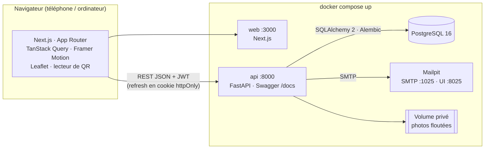
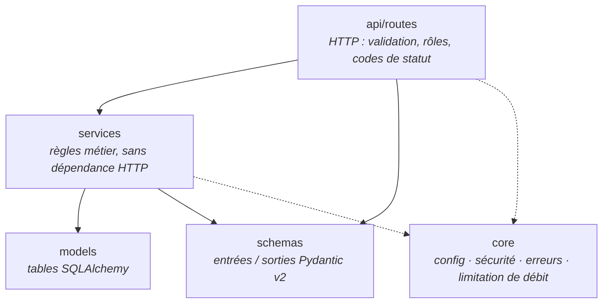
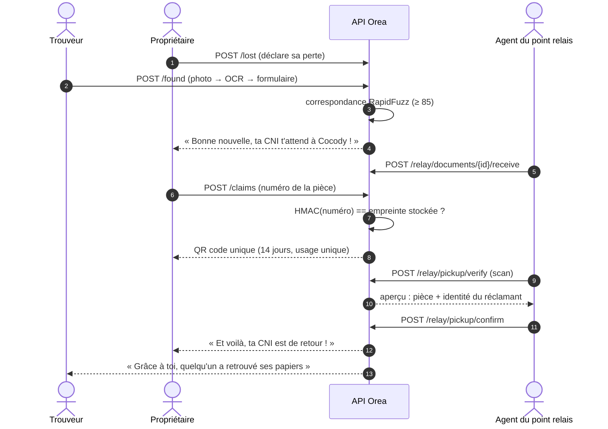
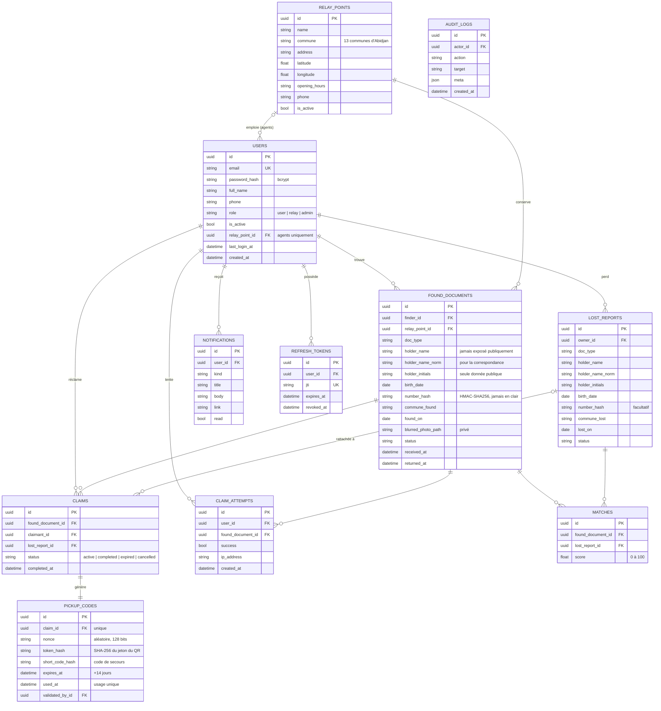
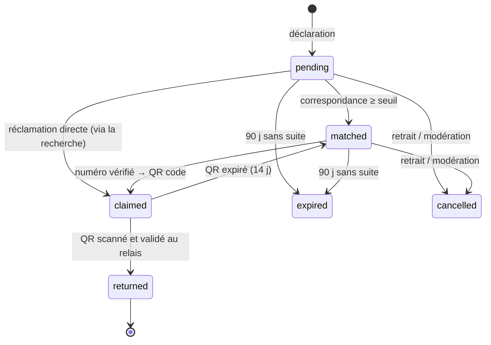

# Orea — Architecture et base de données

## 1. Architecture générale

### Couches du backend

Les routes ne contiennent aucune règle métier : elles valident l'entrée, appellent un
service, valident la transaction (`commit`) puis programment les e-mails. Les services
sont testables directement, et réutilisés par le script de démonstration.

### Parcours « restitution »

## 2. Base de données

### Cycle de vie d'une déclaration

